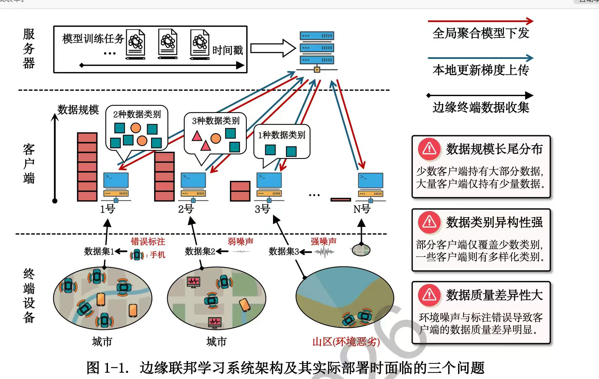
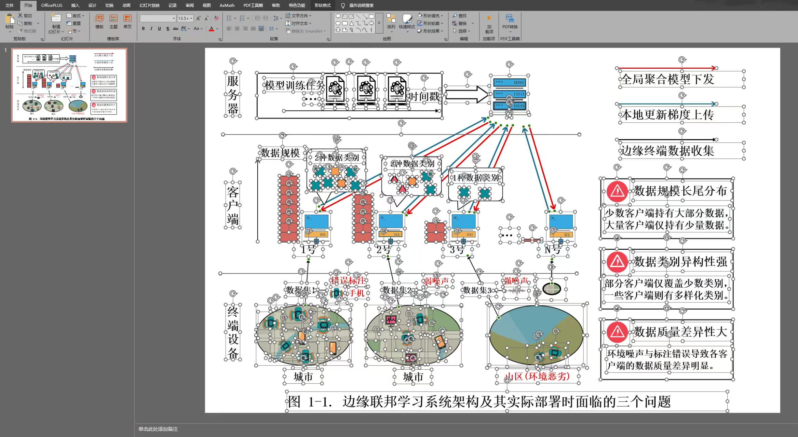
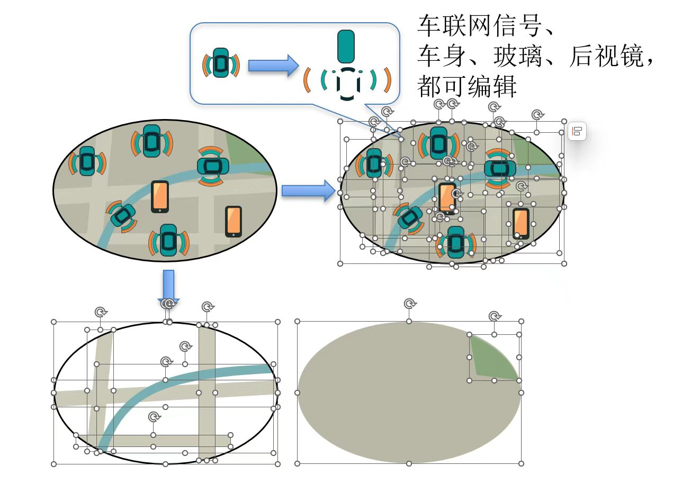
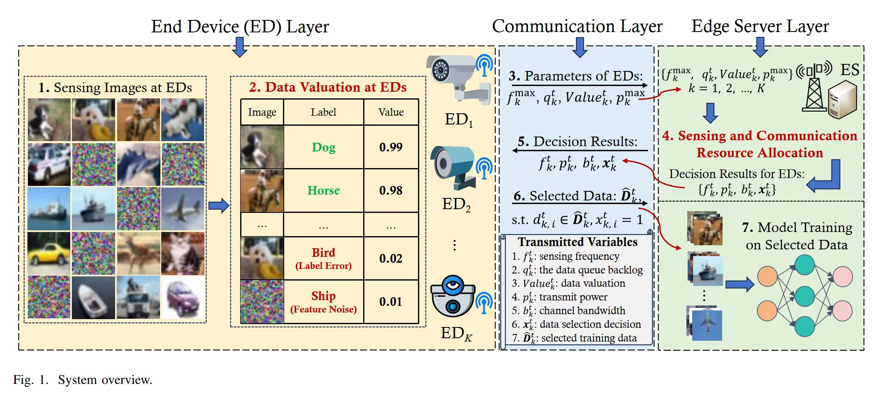
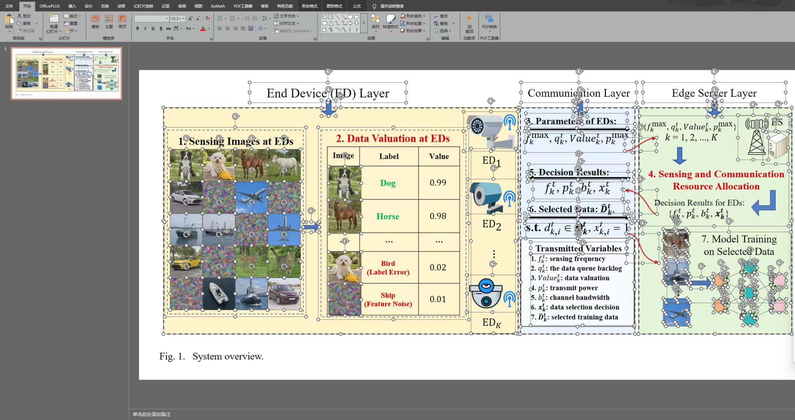
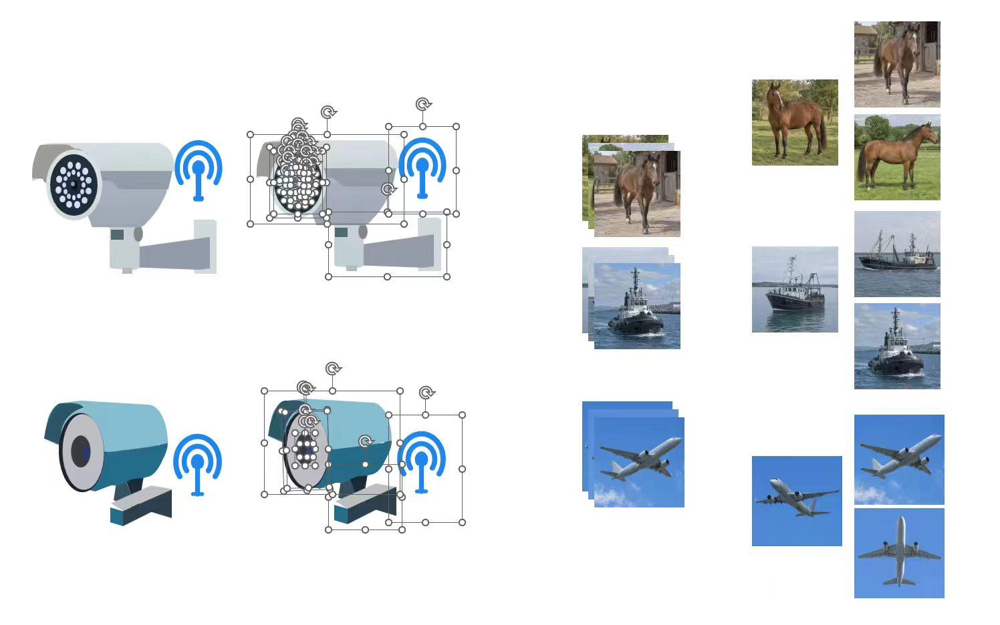
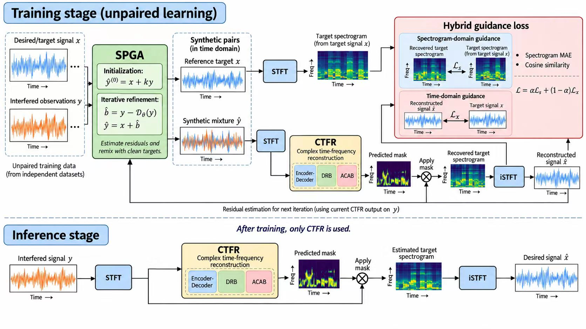
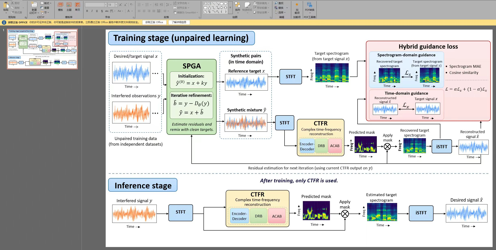
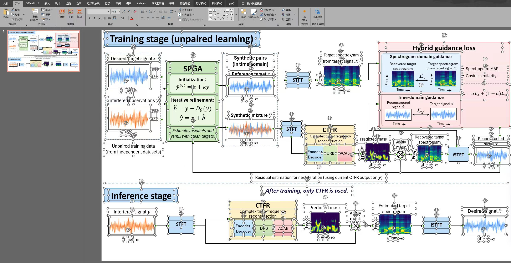

# lotraAI


<!-- workflow-v137:start -->
1.37.2 仍是可移植的 skill：通过项目内 `start → next → submit` 工作包、分批原图观察/绑定、
完整质量验收和正式导出重建 PPT。分批检查点不代表通过；原生构建稿不代表成品。
交付前运行 `delivery-check` 验证当前任务和最终 PPTX 字节。无需更换 harness、
常驻服务或额外模型密钥。可选检查脚本仅供接入方调用，skill 不控制第三方回复。
<!-- workflow-v137:end -->

优先使用通过实际能力检查的本地 PowerPoint／WPS，LibreOffice 作为可选回退。最终文件执行真实导出与保存检查；保存目录可自选，默认项目目录。复用 runtime 1.14.0 二进制；WPS／macOS 必须由对应实机资格检查确认。


**当前发布版本：1.37.2** · 开发／默认分支：`dev` · 版本分支：`1.37.2` · 正式标签：`v1.37.2`

当前 `dev` 与 `1.37.2` 均对应已发布的 1.37.2。分支统一使用 `dev` 或 `X.Y.Z`；正式标签使用 `vX.Y.Z`，不增加其他后缀。


**将科研参考图重建为分层、可编辑的 PowerPoint。**

[English](README.md) · [中文版](README.zh-CN.md)

lotraAI 将当前 agent 对原图的理解与项目内的重建程序结合起来，用于科研系统图、方法流程图和结构示意图。文字、形状、连接与语义分组按原生对象组织；公式使用结构化 Office Math；照片等图像内容保留为适当范围的图片对象。

[快速开始](#快速开始) · [案例](#案例) · [使用指南](docs/usage.zh-CN.md) · [安装说明](docs/installation.zh-CN.md) · [下载完整包](docs/download.zh-CN.md)

## 快速开始

### 1. 让 Codex 安装 skill，并自动准备运行资源

在 Codex 中打开工作项目，把下面这一句话交给它；首次安装和后续更新都适用：

~~~text
请从 https://github.com/jiang-zl/lotraAI-image2slide-skill-runtime 在当前项目安装或更新 lotraAI Image2Slide。
~~~

Codex 调用维护好的安装程序，按平台准备 Python、依赖和 OCR，并资格确认本地公式／演示后端，再登记唯一的 `lotra-image2slide-skill`。下载、续传、校验与分块合并由程序完成，无需逐项手动处理。

如果已有完整 ZIP，提供文件或本地绝对路径，再发送：

~~~text
请用提供的 lotraAI-image2slide-v1.37.2-bundle.zip 在当前项目安装或更新 Image2Slide。
~~~

运行资源和私有任务状态保存在项目 `.lotraAI-build`。手动命令与平台要求见[安装说明](docs/installation.zh-CN.md)，完整包获取方式见[下载说明](docs/download.zh-CN.md)。

### 2. 附上原图开始重建

~~~text
用 $lotra-image2slide-skill 将这张图重建为可编辑 PPT。
~~~

当前 agent 负责解释原图，程序负责执行、检查与导出。工作流交付 `Final_editable.pptx` 和记录实际完成情况的 `Report.md`。

## 按系统下载安装

也可以先进入要使用 Image2Slide 的项目目录，直接执行对应命令。脚本会自动选择当前系统和架构，首次安装与后续更新使用同一入口。

**Windows（PowerShell）**

```powershell
$url = 'https://raw.githubusercontent.com/jiang-zl/lotraAI-image2slide-skill/dev/install-lotra.ps1'
curl.exe -fL --retry 2 --connect-timeout 20 $url -o install-lotra.ps1
if ($LASTEXITCODE -eq 7) { curl.exe --noproxy '*' -fL --retry 2 --connect-timeout 20 $url -o install-lotra.ps1 }
if ($LASTEXITCODE -eq 0) { powershell.exe -NoProfile -ExecutionPolicy Bypass -File .\install-lotra.ps1 -Project (Get-Location).Path }
```

**macOS（终端，Apple Silicon / Intel）**

```sh
curl -fL --retry 2 'https://raw.githubusercontent.com/jiang-zl/lotraAI-image2slide-skill/dev/install-lotra.sh' -o install-lotra.sh && sh install-lotra.sh "$PWD"
```

**Linux / WSL（终端）**

```sh
curl -fL --retry 2 'https://raw.githubusercontent.com/jiang-zl/lotraAI-image2slide-skill/dev/install-lotra.sh' -o install-lotra.sh && sh install-lotra.sh "$PWD"
```

skill 包内也提供 `scripts/install-runtime.ps1` 和 `scripts/install-runtime.sh`，可为指定项目补齐或更新 runtime。各入口共用安装核心，使用相同的资源校验、缓存与差分同步流程。参数和已有解压包的用法见安装说明。

## 能做什么

- **按语义组织对象。** 用原生文字、形状、路径、连接和分组表达图中的结构，便于后续调整；中文和英文分别从对应语种的字体集合中匹配。
- **保留结构化公式。** 数学表达使用源结构与真正的 Office Math，保留公式内部的数学关系。
- **细化图标部件。** 先从原图登记部件、可见细节和相互关系，再递归拆解；优先使用形状、填色和边框，必要时使用原生曲线路径。已完成的构造可复用于同图的重复元素。
- **重建立体结构。** 逐层识别空间类型，建立参考系与姿态；用原生面表达厚度和遮挡，按所在表面检查内容整体居中、方向和底座承载，结合保存结果与实际显示逐项核验。
- **用函数重建曲线。** 有数学含义的曲线保留对应特征，一般曲线用分段函数近似，保留主要趋势、转折和不连续位置。
- **积累自己的绘制方法。** 适合复用且通过验收的构造方法进入本地个性化知识库，供后续任务检索；每张新图仍以自己的原图为依据。
- **项目内准备依赖。** 安装器在本地准备 Python、OCR 和相关程序资源；无需额外模型 API key。当前 agent 服务的运行方式由宿主决定。

## 案例

以下三组案例由作者提供，每组包含原图、PowerPoint 截图和亮点图。点击图片查看原尺寸。截图用于展示重建结构；原生 PPTX 文件和各案例的实际生成版本未随这些图片提供。

### 1. 边缘联邦学习系统

包含服务器、客户端与终端设备三层结构，呈现数据规模长尾、类别异构与观测噪声。

| 原图 | 重建 PowerPoint | 重建亮点 |
|:---:|:---:|:---:|
| <a href="docs/assets/examples/01-edge-federated-learning/original.jpg"></a> | <a href="docs/assets/examples/01-edge-federated-learning/reconstruction.jpg"></a> | <a href="docs/assets/examples/01-edge-federated-learning/highlights.jpg"></a> |

- PowerPoint 截图展示可分别选择的文字、数据条、类别标记、客户端电脑和通信箭头。
- 亮点图展示车辆车身、车窗、后视镜、无线信号弧线与地图图层的部件拆分。

[查看案例说明](docs/examples/01-edge-federated-learning.zh-CN.md)

### 2. 感知与通信系统

由终端、通信、边缘服务器三层组成，包含感知图像、数据估值表、数学标注、资源分配与模型训练。

| 原图 | 重建 PowerPoint | 重建亮点 |
|:---:|:---:|:---:|
| <a href="docs/assets/examples/02-sensing-communication/original.jpg"></a> | <a href="docs/assets/examples/02-sensing-communication/reconstruction.jpg"></a> | <a href="docs/assets/examples/02-sensing-communication/highlights.jpg"></a> |

- 重建截图展示分层面板、表格布局、标签、箭头与训练网络元素的独立选择状态。
- 亮点图展开摄像机外壳、镜头、支架和无线标记，并展示可独立选取的照片；照片本身仍属于图像内容。

[查看案例说明](docs/examples/02-sensing-communication.zh-CN.md)

### 3. 信号重建训练与推理流程

覆盖 SPGA、STFT、CTFR、时频掩码和混合引导损失的训练与推理流程。

| 原图 | 重建 PowerPoint | 重建亮点 |
|:---:|:---:|:---:|
| <a href="docs/assets/examples/03-signal-reconstruction/original.jpg"></a> | <a href="docs/assets/examples/03-signal-reconstruction/reconstruction.jpg"></a> | <a href="docs/assets/examples/03-signal-reconstruction/highlights.jpg"></a> |

- 重建展示保留训练/推理分区，以及围绕波形、频谱内容组织的多层损失面板。
- 选择状态截图展示模块框、标签、箭头、数学标注与反馈路径的独立对象结构。

[查看案例说明](docs/examples/03-signal-reconstruction.zh-CN.md)

## 使用方式

已有半成品时，同时附上原图和对应的一页 PPT，发送：

~~~text
用 $lotra-image2slide-skill 根据原图，基于这份半成品 PPT 继续重建。
~~~

任务中断后，在同一个工作项目中要求继续原来的任务。保留原图和 `.lotraAI-build`，具体操作见[使用指南](docs/usage.zh-CN.md)。

## v1.37.2

本版增加原图线类契约，独立检查保存后的路线、转折、起终点、标记、线型、接触关系和拓扑。每条线都有当前实渲染证据和定位视觉复核，所有疑点需要放大证据并明确闭合。清晰对象在常规检查充分后结束，证据不足时只深入相关对象；不按模型类型选择检查，也不降低质量要求。详见[证据驱动工作流](skills/lotra-image2slide-skill/references/workflow-v1372.md)。空间重建继续沿用 workflow 1.35.2。

从原图到部件逐层识别空间类型，冻结参考系、可观察姿态和原图锚点；按所在表面检查内容整体居中、底座承载、共享边和遮挡。优先使用原生形状、填色和边框。曲线函数、有限收敛控制、私有方法复用及排版后的字体和整图复核继续保留。

安装与更新使用同一入口，按文件差分同步：新增的加入、变化的替换、新版移除的受管理文件删除；未变化的生效文件不重复下载或写入。个人知识库、字体、任务、原图和 PPT 保留在本地，公开包不预置作者的个人知识库。

运行资源覆盖 Windows x64、Linux x64、macOS Apple Silicon 和 Intel。macOS 要求 13 或更高版本，需要 LibreOffice 回退时才单独联网获取 Math 资源；Linux ARM64 尚缺完整 Math 包。具体支持范围见[安装说明](docs/installation.zh-CN.md)。


## 文档与项目结构

| 入口 | 内容 |
| --- | --- |
| [安装](docs/installation.zh-CN.md) | 自动安装、差分更新、完整包与平台要求 |
| [使用](docs/usage.zh-CN.md) | 图片重建、半成品导入与恢复任务 |
| [案例](docs/examples/README.md) | 原图、重建截图与部件细节 |
| [工作流](skills/lotra-image2slide-skill/references/workflow-v1352.md) | 1.37.2 的重建流程与复用规则 |
| [skill 源码](skills/lotra-image2slide-skill/SKILL.md) | 当前 v1.37.2 的完整主载荷 |
| [来源与许可](NOTICE.md) | 项目源码、第三方组件和案例素材 |

需要反馈时，请描述系统、产品版本、具体操作和相关诊断；按需提供经过检查的原图或片段。项目内的私有任务数据由你管理。

## 本地软件与保存目录

后端必须通过真实 PDF 导出、编辑、保存、重开检查，程序存在不等于可用。Windows PowerPoint 已由测试主机验证；WPS 与 macOS PowerPoint 适配器需要对应主机的实际资格检查。公式保持可编辑 OMML。LibreOffice 回退使用任务自有 TEMP／配置目录，PNG 预览不计为 PDF 导出成功。

可以直接告诉 Agent“保存到 DIRECTORY”，默认保存根目录为当前项目。每次导出建立 `output-slide-YYYY-MM-DD-HHMMSS-mmm`，只交付 `Final_editable.pptx` 和 `Report.md`；任务、探测与日志留在 `.lotraAI-build`。通过项目启动器运行 `presentation-backend --project PROJECT` 检查能力，`presentation-backend --project PROJECT --backend powerpoint --save-preferences` 保存偏好，`export TASK --output-root DIRECTORY` 指定目录，`validate-presentation FILE --project PROJECT --out NEW_AUDIT_DIRECTORY` 检查副本。明确指定的后端不可用时报告具体原因。保留已有文件。
